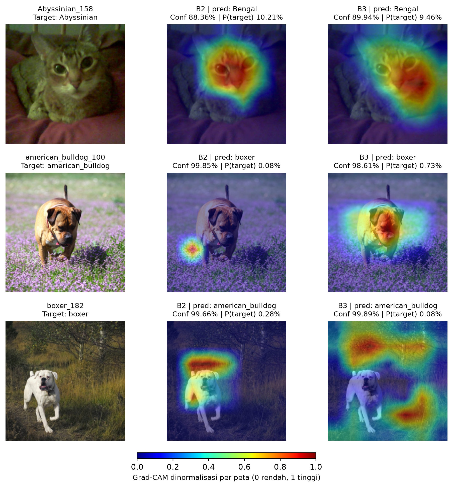

# Oxford-IIIT Pet — Advanced CNNs and Transfer Learning

Eksperimen klasifikasi 10 ras Oxford-IIIT Pet untuk Tugas Sesi 05. Repository memuat notebook dengan output eksekusi, dependensi, serta kode dan hasil Grad-CAM. Laporan dan arsip hasil lengkap disertakan dalam ZIP pengumpulan tugas.

[Buka notebook di Google Colab](https://colab.research.google.com/github/geraldadli/Oxford-IIIT-Pet/blob/main/Bagian_B_Eksperimen_Praktik.ipynb)

## Isi repository

- `Bagian_B_Eksperimen_Praktik.ipynb`: notebook B1–B5 beserta output eksekusi yang disimpan.
- `requirements.txt`: dependensi untuk lingkungan baru; Colab memakai pasangan PyTorch/torchvision bawaan.
- `gradcam/`: script, visualisasi, prediksi, peta numerik, dan metadata verifikasi C5.
- `results/`: ringkasan, log training, prediksi test, manifest, konfigurasi, versi aktual, dan grafik B1–B5.

Dataset, bobot pretrained, dan checkpoint `best.pt` tidak disimpan dalam Git. Dataset diunduh otomatis oleh notebook. Checkpoint tersedia dalam arsip hasil eksperimen yang dikumpulkan terpisah.

## Menjalankan di Colab

1. Buka notebook melalui tautan di atas dan pilih runtime **T4 GPU**.
2. Simpan salinan notebook. Jalankan sel secara berurutan dan otorisasi Google Drive saat diminta.
3. Periksa pembagian kelas, contoh citra, augmentasi, dan self-check sebelum training.
4. Jalankan B1–B5, lalu ringkasan validasi, pemilihan model, dan evaluasi test. Jangan menggunakan test untuk tuning.
5. Unduh notebook dengan output dan arsip hasil dari `RUN_DIR`.

Notebook membuat folder run baru. Jangan menjalankan ulang sel training pada folder eksperimen yang sudah ada; proteksi overwrite memang disengaja. Checkpoint yang tersimpan merupakan model terbaik berdasarkan validation loss, bukan state lengkap untuk melanjutkan optimizer. Run terputus tidak boleh dianggap selesai.

Beberapa pengantar Markdown notebook merupakan petunjuk awal sebelum B5 ditambahkan. Sel B5 dan outputnya merupakan bukti eksekusi pembanding EfficientNet-B0; nama run selesai adalah `B5_efficientnet_b0_aug_retry1`.

## Protokol eksperimen

Data terdiri dari 1.977 citra, dibagi secara stratified menjadi 1.384 train, 297 validation, dan 296 test. Sepuluh kelas mencakup Abyssinian, Bengal, Birman, Bombay, British Shorthair, American Bulldog, Beagle, Boxer, Chihuahua, dan English Cocker Spaniel. Split internal dibentuk dari gabungan daftar trainval/test resmi; hasil ini bukan benchmark pada official test split Oxford.

Konfigurasi bersama: seed 42, input 224 × 224, normalisasi ImageNet, batch 32, AdamW, weight decay 0,01, maksimum 30 epoch, early stopping patience 4, dan pemilihan checkpoint berdasarkan minimum validation loss. Head memakai learning rate 0,001; blok backbone yang dibuka memakai 0,0001. B3 dan B5 menjalani warmup head selama dua epoch. Training dilakukan pada Tesla T4 di Colab.

| Kondisi | Konfigurasi | Augmentasi | Val accuracy (%) | Test Macro F1 (%) | Training + evaluasi (detik) |
|---|---|---|---:|---:|---:|
| B1 | ResNet-18 dari nol | Ya | 39,39 | 40,51 | 237,59 |
| B2 | ResNet-18 feature extraction | Ya | 96,63 | 95,97 | 644,52 |
| B3 | ResNet-18 progressive fine-tuning | Ya | 95,96 | 96,60 | 276,64 |
| B4 | ResNet-18 feature extraction | Tidak | 96,30 | 96,28 | 334,29 |
| B5 | EfficientNet-B0 progressive fine-tuning | Ya | 97,31 | 97,64 | 265,80 |

B4 dibandingkan dengan run B2 yang sama, bukan replikasi independen. B5 dipilih melalui validation loss sebelum test. Waktu mencakup training dan evaluasi train/validation, tidak termasuk unduhan, test, atau checkpoint I/O. Seluruh angka berasal dari eksekusi eksperimen; pengujian hanya menggunakan satu seed.

## Lingkungan lokal

```bash
python -m venv .venv
# Aktifkan .venv sesuai sistem operasi Anda.
python -m pip install -r requirements.txt
jupyter notebook Bagian_B_Eksperimen_Praktik.ipynb
```

Untuk GPU lokal, gunakan instalasi PyTorch yang sesuai dengan CUDA/perangkat Anda melalui [panduan resmi](https://pytorch.org/get-started/locally/). Dependensi tidak dipin untuk memaksakan versi CUDA Colab pada mesin lain. Versi aktual dicatat oleh notebook dalam `environment.json` dan `requirements_actual.txt` pada arsip run. Hasil lintas versi dan perangkat tidak dijamin identik.

## Grad-CAM tanpa retraining

Siapkan folder hasil dengan struktur berikut dari ZIP eksperimen:

```text
hasil/
  split_manifest.csv
  B2_aug/best.pt
  B2_aug/test_predictions.csv
  B3_progressive_aug/best.pt
  B3_progressive_aug/test_predictions.csv
images/
  Abyssinian_158.jpg
  american_bulldog_100.jpg
  boxer_182.jpg
```

```bash
python gradcam/generate_gradcam.py --results hasil --images images --out gradcam_baru
```

Script memuat checkpoint secara read-only dan tidak melakukan training. Ia memverifikasi SHA-256 citra terhadap manifest, keanggotaan test, prediksi/confidence terhadap log, serta formula Grad-CAM terhadap bentuk CAM ekuivalen untuk ResNet dengan global average pooling dan linear head. CPU cukup untuk tiga citra ini.

Peta menggunakan output `layer4` dan kelas ground truth yang sama untuk kedua model. B2 epoch 25 dibandingkan dengan B3 epoch 8. **B2 bukan checkpoint B3 tepat sebelum fine-tuning**; perbedaan head dan durasi training juga memengaruhi hasil. Setiap peta dinormalisasi sendiri, sehingga intensitas bukan ukuran bukti absolut yang dapat dibandingkan antar-peta. Ketiga citra dipilih dari kesalahan B5 dan tidak mewakili seluruh test set.



## Atribusi dan penggunaan AI

Implementasi model, transformasi, dan pengunduhan dataset menggunakan PyTorch/torchvision. Notebook disusun dengan bantuan Codex untuk kode, debugging, dan penjelasan konsep. Codex juga membantu verifikasi metrik, script Grad-CAM, draf pembahasan, dan dokumentasi. Eksperimen training dijalankan mahasiswa melalui Colab. Analisis akhir dan pemahaman kode tetap menjadi tanggung jawab mahasiswa; disclosure lengkap disertakan pada laporan.

- [Oxford-IIIT Pet dataset — University of Oxford](https://www.robots.ox.ac.uk/~vgg/data/pets/)
- [torchvision OxfordIIITPet](https://docs.pytorch.org/vision/stable/generated/torchvision.datasets.OxfordIIITPet.html)
- [PyTorch transfer learning tutorial](https://docs.pytorch.org/tutorials/beginner/transfer_learning_tutorial.html)
- [ResNet — He et al., 2016](https://arxiv.org/abs/1512.03385)
- [Transferability of features — Yosinski et al., 2014](https://arxiv.org/abs/1411.1792)
- [EfficientNet — Tan dan Le, 2019](https://proceedings.mlr.press/v97/tan19a.html)
- [Grad-CAM — Selvaraju et al., 2017](https://arxiv.org/abs/1610.02391)
- Materi kuliah: Hidayaturrahman, *Advanced CNNs and Transfer Learning*, Sesi 05.
